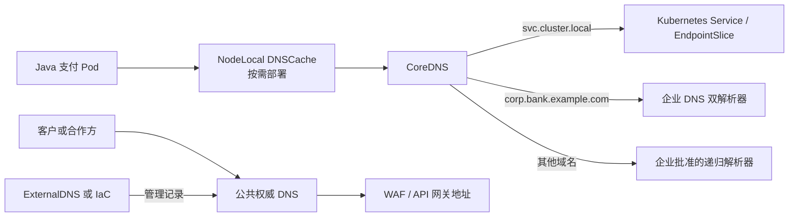

# 银行支付系统的 Kubernetes DNS 设计与实施

本文模拟银行信用卡、授权、付款和退款 API 的生产环境，给出可选 DNS 管理方式、实施示例、监控及恢复方法。编写日期：2026-09-07。

本文是设计与操作文档；没有修改当前 CoreDNS、部署 ExternalDNS 或创建企业域名。配置中的 `bank.example.com` 是示例域名，`10.20.0.53`、`10.21.0.53` 等是规划地址，执行前必须替换为银行实际管理的域名、解析器地址和镜像版本。下面的命令默认使用 PowerShell；Corefile、YAML 和 Java properties 是对应文件的内容。

伪代码补充日期：2026-09-08。各生产设计段落下的 `pseudocode` 块描述设计逻辑，不是可执行脚本、真实 Kubernetes API 或已完成的部署。`REQUIRE` 表示前提不满足则停止该流程；`VERIFY` 表示收集实际证据，失败时不进入下一阶段；`STOP` 表示停止并报告原因。所有超时、阈值、域名、故障域和版本从经过评估的 `config` 读取，不能把规划示例直接当成生产参数。文中的现场配置表保留为 2026-09-07 检查快照。

## 1. 当前项目与生产假设

本次只读检查确认当前 Docker Desktop 集群配置如下：

| 项目 | 当前值 |
| --- | --- |
| 集群服务域 | `cluster.local` |
| DNS 实现 | CoreDNS，Deployment 配置 2 个副本 |
| DNS Service | `kube-dns.kube-system`，ClusterIP `10.96.0.10` |
| 端口 | UDP/TCP 53；CoreDNS 指标 TCP 9153 |
| 外部域名转发 | `forward . /etc/resolv.conf` |
| 应用命名空间 | `monitoring-demo` |
| 应用 Service | `production-simulator-production-simulator`，端口 18080 |

两个 CoreDNS 副本位于单节点演示集群中，不能抵御节点故障。当前 Grafana 在 Docker 中运行，通过 `host.docker.internal:19090` 访问 Prometheus；它不是集群 Pod，不能假定它可以解析 `*.svc.cluster.local`。

生产设计假设：至少三个可用区或独立故障域；支付服务位于 `payments-prod` 命名空间；银行提供两套可达的企业 DNS 解析器；数据库、风控、HSM 和核心账务服务有私有域名；对公网只暴露受控 API 网关。实际基础设施与这些假设不同时，应调整方案。

**伪代码 P01：验证生产前提。** 输出为差异报告；失败不意味着自动创建缺失基础设施。

```pseudocode
inventory = inspect_target_environment(config.cluster)
gaps = []
CHECK inventory.independent_failure_domains >= 3 ELSE gaps.ADD("故障域不足")
CHECK namespace_exists("payments-prod") ELSE gaps.ADD("生产命名空间缺失")
CHECK count(config.enterprise_resolvers) >= 2 ELSE gaps.ADD("企业解析器不足")
FOR resolver IN config.enterprise_resolvers:
    CHECK reachable_from_dns_network(resolver, UDP_AND_TCP_53)
          ELSE gaps.ADD(resolver + " 不可达")
FOR dependency IN [database, risk_engine, HSM, ledger]:
    CHECK owned_private_fqdn_exists(dependency) ELSE gaps.ADD(dependency)
CHECK public_exposure_is_limited_to_managed_gateway(inventory)
      ELSE gaps.ADD("存在非预期公网入口")
IF gaps IS NOT EMPTY: STOP with architecture_revision_report(gaps)
RETURN validated_inventory(inventory)   # 演示集群不能据此标记为生产就绪
```

## 2. DNS 管理方式如何选择

| 方式 | 适合的银行场景 | 实施组件 | 边界 |
| --- | --- | --- | --- |
| Kubernetes Service DNS | 同集群服务发现 | CoreDNS + ClusterIP Service | DNS 返回 Service 地址；流量分发由服务网络实现 |
| Headless Service | 需要发现独立副本的有状态集群 | `clusterIP: None` + StatefulSet | 返回端点地址，客户端承担发现和连接管理 |
| 条件转发 | 访问企业数据库、HSM、风控域名 | CoreDNS `forward` + 企业 DNS | 私有查询只发往企业解析器 |
| NodeLocal DNSCache | 大量 Pod 查询、降低重复解析开销 | 节点级 DNS 缓存 DaemonSet | 增加节点运维和 CNI 适配复杂度 |
| 手工/IaC 管理权威记录 | 稳定的公共支付入口、严格变更管理 | 企业 DDI、云 DNS、Terraform 等 | 每次记录变更走代码评审或企业 DNS 流程 |
| ExternalDNS 自动管理记录 | 网关地址随 Kubernetes 资源变化 | ExternalDNS + DNS Provider API | 只管理授权子域，不能自动提供网关或 TLS |
| 分视图 DNS | 同名入口需要返回内部/外部不同地址 | 企业 DNS view、私有/公共 zone | 两套解析视图需分别测试和管理 |
| 多集群/GSLB | 主备、区域故障切换 | 全局 DNS/LB + 区域网关 | DNS 不解决支付账本复制与幂等问题 |

推荐组合：**CoreDNS 服务发现 + 企业私有域条件转发 + 独立管理的公网入口域名**。达到规模后再评估 NodeLocal DNSCache。稳定的支付入口可优先用 IaC 管理；动态内部入口可用限定权限的 ExternalDNS。

**伪代码 P02：按需求选择管理方式。** 允许多个选项组合，但同一 DNS 记录只确定一个写入责任方。

```pseudocode
plan = {service_discovery: CoreDNS, private_resolution: enterprise_forwarding}
FOR service IN inventory.services:
    IF service.requires_replica_discovery: plan.ADD(Headless_Service)
    ELSE IF service.is_in_cluster: plan.ADD(ClusterIP_Service)
FOR entry IN inventory.entrypoints:
    IF entry.address_is_stable: assign_record_writer(entry, IaC_pipeline)
    ELSE: assign_record_writer(entry, scoped_ExternalDNS_instance)
    IF entry.needs_internal_and_external_answers: plan.ADD(split_DNS_views)
IF config.requires_regional_failover: plan.ADD(GSLB_and_data_failover_design)
IF measured_dns_load_exceeds_budget AND platform_supports_NodeLocal:
    plan.ADD(NodeLocal_preproduction_trial)
VERIFY no_record_has_competing_writers(plan)
RETURN plan
```



图中的箭头表示解析与记录管理关系。DNS 返回地址后，API 请求直接进入相应服务或网关，不经过 DNS 服务器转发业务请求。

## 3. 集群内部服务发现

### 3.1 普通 Service

当前项目应用的完整 DNS 名为：

```text
production-simulator-production-simulator.monitoring-demo.svc.cluster.local
```

同命名空间可使用短名称；跨命名空间建议写出命名空间，配置中可使用完整域名，避免搜索域歧义。

生产支付 Service 示例，保存为 `payment-service.yaml`。它需要已有带相同标签、监听 8080 的应用 Pod：

```yaml
apiVersion: v1
kind: Service
metadata:
  name: payment-api
  namespace: payments-prod
spec:
  selector:
    app: payment-api
  ports:
    - name: http
      port: 8080
      targetPort: 8080
  type: ClusterIP
```

```powershell
kubectl apply -f payment-service.yaml
kubectl -n payments-prod get endpointslice -l kubernetes.io/service-name=payment-api
```

内部地址为 `payment-api.payments-prod.svc.cluster.local:8080`。这并没有配置 TLS；生产 API 仍应按内部通信要求配置 TLS/mTLS、认证和网络访问策略。

**伪代码 P03：发布内部支付 Service 并验证访问边界。**

```pseudocode
REQUIRE namespace_exists("payments-prod")
pods = select_pods(namespace="payments-prod", label="app=payment-api")
REQUIRE pods IS NOT EMPTY AND ready_pods_listen_on(pods, 8080)
reconcile_ClusterIP_Service("payment-api", selector=pods.label, port=8080)
WAIT UNTIL ready_endpoints_exist("payment-api") WITHIN config.rollout_timeout
VERIFY dns_answer_matches_service_IP("payment-api.payments-prod.svc.cluster.local")
configure_service_TLS_or_mesh_mTLS(config.internal_identity_policy)
configure_authentication_and_network_access(config.allowed_callers)
VERIFY permitted_caller_completes_synthetic_request()
VERIFY unauthorized_caller_is_rejected()
IF verification_failed: revert_this_change_and_report()
```

### 3.2 Headless Service 与 ExternalName

需要副本级发现时，可创建 `clusterIP: None` 的 Service，并让 StatefulSet 的 `spec.serviceName` 指向它。例如：`ledger-0.ledger-headless.payments-prod.svc.cluster.local`。只有实际运行的控制器、端点和就绪状态配合，DNS 记录才有预期意义。不要把 `publishNotReadyAddresses: true` 当作修复支付流量可用性的通用选项。

`ExternalName` 可以为集群外数据库创建 DNS 别名：

```yaml
apiVersion: v1
kind: Service
metadata:
  name: ledger-db
  namespace: payments-prod
spec:
  type: ExternalName
  externalName: ledger-db.corp.bank.example.com
```

它返回 CNAME，不创建数据库代理、健康检查或网络通道。客户端 TLS 证书名称、SNI、HTTP Host 和连接池行为仍须与目标服务匹配。若客户端使用别名进行证书校验，证书必须覆盖该名称，或直接配置目标域名。

参考：[Kubernetes Service 与 Pod DNS](https://kubernetes.io/docs/concepts/services-networking/dns-pod-service/)。

**伪代码 P04：有状态副本发现与外部依赖别名。**

```pseudocode
IF application.requires_individual_replica_addresses:
    reconcile_headless_Service(name="ledger-headless", publishNotReadyAddresses=false)
    reconcile_StatefulSet(serviceName="ledger-headless")
    WAIT UNTIL intended_replicas_are_ready WITHIN config.rollout_timeout
    VERIFY DNS_returns_expected_ready_endpoint_addresses()
    VERIFY client_handles_endpoint_removal_and_connection_recovery()
    IF bootstrap_requires_unready_discovery:
        design_separate_bootstrap_path_without_payment_traffic()
IF dependency.requires_ExternalName_alias:
    REQUIRE private_target_resolves AND network_path_exists
    connection_name = choose_alias_only_if_certificate_covers_alias_else_target()
    reconcile_ExternalName(alias="ledger-db", target=config.ledger_fqdn)
    VERIFY client_uses_correct_SNI_and_verifies_certificate(connection_name)
    VERIFY database_connection_and_pool_recovery()  # CNAME 本身不提供代理
```

## 4. 企业私有域条件转发

### 4.1 域名规划

| 域 | 所有者 | 解析范围 |
| --- | --- | --- |
| `svc.cluster.local` | Kubernetes | 集群内部服务 |
| `corp.bank.example.com` | 企业 DNS 团队 | 数据库、HSM、风控等私有服务 |
| `apps.prod.bank.example.com` | 平台团队获授权的子域 | 内部网关与动态应用入口 |
| `api.bank.example.com` | 公网 DNS/边界团队 | 公共支付 API 入口 |

不要把默认 `cluster.local` 作为企业公共域发布。多个集群可以各自使用这个集群域，但不能把不同集群的同名 Service 默认视为同一目标。

**伪代码 P05：分配域名所有权与发布范围。**

```pseudocode
FOR zone IN config.zones:
    REQUIRE zone.owner AND zone.visibility AND zone.authoritative_service
    VERIFY parent_delegation_or_private_zone_association(zone)
    grant_writer_access_only_to_assigned_zone(zone.owner, zone)
    IF zone.is_cluster_service_domain: reject_public_publication(zone)
FOR record IN requested_records:
    REQUIRE record.zone.contains(record.name) AND record.writer == record.zone.owner
    IF record.is_cluster_local: scope_identity_by(cluster, namespace, service)
    record_inventory.ADD(name, zone, owner, intended_view, change_reference)
VERIFY no_unplanned_zone_overlap_or_delegation_conflict()
```

### 4.2 CoreDNS 修改步骤

先导出现有配置并保存到变更记录中：

```powershell
kubectl -n kube-system get configmap coredns -o yaml | Set-Content -Encoding utf8 coredns-backup.yaml
kubectl -n kube-system get deployment coredns -o yaml | Set-Content -Encoding utf8 coredns-deployment-backup.yaml
kubectl -n kube-system get configmap coredns -o jsonpath='{.data.Corefile}'
```

在现有 `Corefile` 中增加下面的独立 server block。**保留现有根区块及其 `kubernetes`、`health`、`ready`、`prometheus`、`loop`、`reload` 等插件配置**：

```text
corp.bank.example.com:53 {
    errors
    cache 30
    forward . 10.20.0.53 10.21.0.53 {
        policy random
        health_check 5s
        max_concurrent 1000
    }
}
```

该域及其子域转发到企业解析器。根区块中的默认上游也应改为企业批准的递归解析器，例如把 `forward . /etc/resolv.conf` 替换为同一组企业上游，而不是同时添加第二个默认转发块。容量参数应通过压测调整。

企业解析器可以在自身完成公共递归，同时权威回答私有区。避免把企业私有域失败请求回退到公共 DNS，防止泄漏内部名称。两个解析器应有独立故障域、相同私有区数据和一致访问策略。

将编辑后的完整 ConfigMap 保存为 `coredns-production.yaml`，先检查差异，再应用：

```powershell
kubectl diff -f coredns-production.yaml
kubectl apply -f coredns-production.yaml
kubectl -n kube-system logs deployment/coredns --tail=100
```

`reload` 插件会检测配置变化；必须用实际查询确认新配置生效。托管 Kubernetes 可能由附加组件管理器覆盖配置，应使用平台支持的扩展配置接口。备份 YAML 回滚前应清理服务器管理字段，并检查期间是否有其他团队变更，避免覆盖无关修改。

**伪代码 P06：双上游条件转发及配置发布。** 这是配置管理流程；实际请求转发由 CoreDNS 插件执行。

```pseudocode
REQUIRE resolvers_have_independent_failure_domains()
VERIFY private_zone_answers_are_consistent(config.enterprise_resolvers)
base = read_current_CoreDNS_configuration_and_version()
candidate = copy(base)
candidate.upsert_private_zone_forward(config.private_zone, config.enterprise_resolvers)
candidate.replace_default_forward(config.approved_recursive_resolvers)
VERIFY existing_cluster_DNS_and_health_plugins_are_preserved(candidate)
VERIFY no_forwarding_cycle(candidate, enterprise_resolver_configuration)
validate_with_pinned_CoreDNS_version_in_preproduction(candidate)
VERIFY UDP_TCP_private_public_and_service_queries_pass(candidate)
REQUIRE live_configuration_version == base.version  # 防止覆盖并发变更
apply_via_platform_supported_configuration_interface(candidate)
WAIT UNTIL configuration_reload_is_observed WITHIN config.reload_timeout
IF query_verification_fails:
    restore_owned_changes_if_no_concurrent_conflict(base)
    STOP with reload_logs_and_query_evidence
# 私有区只配置企业上游；企业上游均不可用时不追加公共 DNS 回退。
```

### 4.3 转发与加密注意点

UDP 和 TCP 53 都需要可达；只开放 UDP 会导致 TCP 回退失败。上游不可指向会把同一查询再转回 CoreDNS 的解析器，也不要盲目使用节点的本地 stub 地址作为容器上游。当前 `loop` 插件可检测部分简单循环，但不能代替完整链路检查。

若企业提供 DNS-over-TLS，可按 CoreDNS `forward` 文档配置 `tls://IP:853`、`tls_servername` 及受信 CA。两台上游应符合配置的证书名称要求。不要关闭证书验证；DoT 保护传输，DNSSEC 提供不同层面的数据真实性验证。DNSSEC 签名/验证应由相应权威与递归系统明确承担。

参考：[自定义集群 DNS](https://kubernetes.io/docs/tasks/administer-cluster/dns-custom-nameservers/)、[CoreDNS forward](https://coredns.io/plugins/forward/)、[CoreDNS loop](https://coredns.io/plugins/loop/)。

**伪代码 P07：验证网络、DoT 与 DNSSEC 边界。**

```pseudocode
FOR resolver IN config.upstreams:
    VERIFY allowed_path_from_CoreDNS(resolver, config.transport)
    VERIFY resolver_does_not_forward_this_zone_back_to_CoreDNS()
    IF config.transport == DoT:
        REQUIRE enterprise_DoT_endpoint_is_available
        VERIFY TLS_CA_chain_hostname_and_expiry(resolver, config.tls_servername)
        configure_TLS_forward_without_insecure_bypass(resolver)
    ELSE:
        VERIFY both_UDP_and_TCP_53_work(resolver)
IF config.requires_DNSSEC:
    VERIFY authoritative_signing_and_recursive_validation_are_assigned()
    VERIFY valid_signed_answer_passes_and_bogus_answer_is_rejected_in_test_zone()
IF any_verification_fails: STOP with failing_layer   # 不自动降级加密或校验
```

## 5. 高可用与 NodeLocal DNSCache

### 5.1 CoreDNS 跨故障域部署

生产中按容量规划运行多个 CoreDNS 副本，用 Pod anti-affinity 或 topology spread 分散到节点/可用区，并配置资源 requests、limits 与 PodDisruptionBudget。以下为需要合并到现有 Deployment 的片段，不是完整清单：

```yaml
spec:
  replicas: 3
  template:
    spec:
      topologySpreadConstraints:
        - maxSkew: 1
          topologyKey: kubernetes.io/hostname
          whenUnsatisfiable: DoNotSchedule
          labelSelector:
            matchLabels:
              k8s-app: kube-dns
```

标签必须与实际 CoreDNS Pod 一致。可另加可用区约束，但必须先确认节点有对应标签和足够容量。单节点 Docker Desktop 不适用该三节点硬分散配置。PDB 只约束自愿驱逐，不能保证节点突然宕机时的可用性。

**伪代码 P08：按故障域和容量发布高可用 CoreDNS。**

```pseudocode
REQUIRE eligible_nodes_span(config.required_failure_domains)
capacity = benchmark_DNS_under_peak_load_and_one_domain_failure()
desired = size_replicas_and_resources(capacity, config.latency_SLO)
placement = spread_across_nodes_and_zones_using_actual_labels(desired)
VERIFY scheduler_can_place_all_replicas(placement)
configure_PDB_for_planned_disruptions(config.min_available)
roll_out_in_bounded_batches(placement, desired.resources)
VERIFY actual_ready_pod_distribution_matches_plan()
VERIFY synthetic_DNS_and_payment_tests_meet_SLO()
IF Pods_pending OR latency_regresses: pause_rollout_and_restore_previous_plan()
# 非自愿故障还需用剩余副本实测；不能以 PDB 存在作为验收证据。
```

### 5.2 NodeLocal 实施路径

NodeLocal DNSCache 在每个节点运行 DNS 缓存，适用于规模扩大后的热点查询。建议按以下顺序实施：

1. 检查 CNI、kube-proxy 模式及平台对 NodeLocal 的支持；选择不冲突的本地监听地址，例如规划值 `169.254.20.10`。
2. 获取与目标 Kubernetes 版本匹配的官方 `nodelocaldns.yaml`，固定版本保存到仓库，审查其 hostNetwork、权限、监听地址及资源配置。
3. 依据官方模板说明替换集群 DNS IP、集群域、本地监听地址与上游占位符；不要在占位符未替换时应用。
4. iptables 模式可按官方设计同时监听 Service IP 和本地地址；IPVS 模式通常需要将 kubelet `clusterDNS` 改为本地监听地址。eBPF 服务实现应遵循所用 CNI 文档。
5. 先在独立预生产节点池测试，再部署 DaemonSet。需要更改 kubelet DNS 设置时，使用节点配置管理逐批更新并重建测试 Pod，检查 `/etc/resolv.conf`。
6. 验证缓存命中、上游故障、节点缓存进程重启和新 Pod 解析。确认依赖本地地址的 Pod 全部迁回正确 DNS 地址后，才能卸载缓存组件。

不建议在本项目中直接复制生产 DaemonSet：Docker Desktop 的节点配置和网络实现受平台管理。参考：[NodeLocal DNSCache 官方实施步骤](https://kubernetes.io/docs/tasks/administer-cluster/nodelocaldns/)。

**伪代码 P09：NodeLocal 按平台逐批启用及有序回滚。**

```pseudocode
REQUIRE platform_and_CNI_support_NodeLocal(config.versions)
REQUIRE local_DNS_IP_has_no_address_or_listener_conflict()
manifest = render_pinned_official_template(actual_cluster_DNS_IP, cluster_domain,
                                          local_DNS_IP, approved_upstreams)
VERIFY no_unresolved_placeholders(manifest)
IF proxy_mode == IPVS: migration = kubelet_clusterDNS_change_plan(local_DNS_IP)
ELSE IF proxy_mode == iptables: migration = supported_dual_listener_plan()
ELSE: migration = vendor_validated_CNI_plan_or_STOP()
FOR batch IN preproduction_then_production_node_batches:
    deploy_and_verify_local_cache_ready(batch)
    apply_required_node_DNS_configuration(migration, batch)
    recreate_test_Pods_and_check_resolv_conf(batch)
    VERIFY cache_restart_upstream_failure_and_query_SLO_tests(batch)
    IF failed:
        restore_previous_kubelet_DNS_configuration(batch)
        migrate_and_verify_all_Pods_using_local_DNS_address(batch)
        remove_cache_only_after_no_remaining_dependencies(batch)
        STOP with batch_report
```

## 6. 公共与私有入口域名的自动管理

### 6.1 先准备流量入口

DNS 记录应指向稳定、可达的负载均衡器或 API 网关地址。生产支付入口通常还包含 WAF、TLS、认证、限流和审计。当前项目的 `18080` LoadBalancer 是测试服务，不能直接等同于生产公网支付入口。

DNS 不创建网关控制器，也不签发证书。必须先部署所选 Ingress/Gateway 控制器、准备 TLS 证书并验证业务入口，再管理域名记录。

**伪代码 P10：网关就绪后才发布入口域名。**

```pseudocode
REQUIRE gateway_controller_and_network_path_are_available
provision_gateway_address_and_certificate(config.entry_fqdn)
configure_WAF_authentication_rate_limit_and_redacted_audit()
VERIFY TLS_and_test_API_using_target_IP_with_intended_Host_and_SNI()
VERIFY public_requests_cannot_bypass_gateway_to_backend()
IF any_verification_fails: STOP without_publishing_DNS_record
publish_via_assigned_record_writer(config.entry_fqdn, verified_gateway_address)
VERIFY authoritative_then_recursive_resolution_then_HTTPS_request()
IF verification_failed: stop_writer_and_restore_owned_record_change()
```

### 6.2 ExternalDNS 管理模式

ExternalDNS 监听 Kubernetes 资源，并通过 DNS Provider API 创建或更新权威记录。它不是解析器，不接管 CoreDNS 的服务发现。

建议独立部署内部和外部实例：不同 ServiceAccount、Provider 凭据、zone 范围和 TXT owner。云环境可用工作负载身份；企业 DNS 若支持 RFC2136，可用专用 TSIG 密钥。选择具体 Provider 前确认当前固定版本是否内置支持，或是否需要 webhook。

下面是 **ExternalDNS v0.22.0 容器参数片段**，以企业 RFC2136 为例，依据该版本对应的官方示例；还需按官方清单配置 Deployment、ServiceAccount、资源观察 RBAC、Secret、资源限制和安全上下文。若采用其他版本，先核对参数与注解兼容性：

```yaml
args:
  - --source=service
  - --namespace=payments-prod
  - --annotation-filter=dns.bank.example.com/managed=true
  - --provider=rfc2136
  - --domain-filter=apps.prod.bank.example.com
  - --rfc2136-host=10.20.0.53
  - --rfc2136-port=53
  - --rfc2136-zone=apps.prod.bank.example.com
  - --rfc2136-tsig-keyname=externaldns-prod.
  - --rfc2136-tsig-secret=$(RFC2136_TSIG_SECRET)
  - --rfc2136-tsig-secret-alg=hmac-sha256
  - --rfc2136-axfr
  - --registry=txt
  - --txt-owner-id=payments-prod-cluster-a
  - --txt-prefix=_externaldns.
  - --policy=upsert-only
  - --interval=1m
  - --dry-run
env:
  - name: RFC2136_TSIG_SECRET
    valueFrom:
      secretKeyRef:
        name: external-dns-tsig
        key: secret
```

`$(RFC2136_TSIG_SECRET)` 由 Kubernetes 根据容器环境变量展开。Secret 应通过企业密钥管理系统注入，不提交明文到 Git，也不在诊断输出中打印解析后的进程参数。

Provider 侧需要预先建立并授权专用 zone，允许所需动态更新和经 TSIG 授权的区域传送；不能让整个企业根域开放写入。根据 Provider 能力将记录类型和更新名称进一步限制。`--domain-filter` 是应用过滤条件，不能代替 DNS 服务端权限。TSIG 提供认证与完整性，不是查询或传送内容加密。

示例网关 Service 注解，合并到实际控制器维护的 LoadBalancer Service，而不是随意添加到内部 ClusterIP：

```yaml
metadata:
  annotations:
    dns.bank.example.com/managed: "true"
    external-dns.kubernetes.io/hostname: gateway.apps.prod.bank.example.com
    external-dns.kubernetes.io/ttl: "60"
```

注解前缀随 ExternalDNS 版本演进；旧教程可能使用 `external-dns.alpha.kubernetes.io`，应按固定版本确认。域名记录 TTL 也可能被 Provider 的特定记录类型限制。

实施步骤：先创建权限与 Secret，固定已评估的镜像版本；以 `--dry-run` 查看计划；确认只操作预期子域与入口；再移除 `--dry-run` 启动写入。验证权威记录、TXT owner、递归解析和 HTTPS 业务请求均正确。

`upsert-only` 不自动删除记录，但仍能更新已有记录，不是零风险模式；删除入口后要有陈旧记录清理流程。TXT owner 应对每个独立管理实例唯一，同一主备逻辑实例才共享 ownership。不同集群不要并发争抢同一记录；切换 ownership 前先停止旧写入者并核对 TXT。

参考：[ExternalDNS 配置参数](https://kubernetes-sigs.github.io/external-dns/latest/docs/flags/)、[RFC2136 实施示例](https://kubernetes-sigs.github.io/external-dns/latest/docs/tutorials/rfc2136/)、[TXT ownership](https://github.com/kubernetes-sigs/external-dns/blob/master/docs/registry/txt.md)。

**伪代码 P11：ExternalDNS、Provider 权限与 ownership 管理。**

```pseudocode
FOR view IN [internal, external]:
    instance = assign_unique_identity_zone_scope_and_TXT_owner(view, cluster_id)
    pin_and_validate_provider_and_controller_versions(instance)
    provision_read_only_Kubernetes_discovery_RBAC(instance)
    provision_provider_permissions_limited_to_owned_zone_and_record_types(instance)
    IF provider == RFC2136:
        provision_zone_update_and_authenticated_transfer_permissions(instance)
        inject_TSIG_from_secret_manager_without_logging_secret()
    ELSE: configure_supported_workload_identity_or_secret_reference()
    run_controller(dry_run=true, policy=upsert_only, instance)
    plan = collect_redacted_planned_changes()
    REQUIRE all_changes_match_namespace_annotation_zone_and_verified_gateway(plan)
    REQUIRE no_conflicting_TXT_owner_or_parallel_record_writer(plan)
    snapshot_owned_records_and_enable_writes(instance)
    VERIFY authoritative_records_TXT_recursive_answers_and_HTTPS()
    IF failed: stop_writer_then_restore_its_owned_record_changes()
WHEN entry_is_removed:
    inventory_stale_records()  # upsert-only 不会自动删除
    remove_only_after_dependency_checks_and_normal_DNS_change_review()
WHEN ownership_changes:
    stop_old_writer(); verify_no_remaining_writes()
    migrate_TXT_ownership_under_controlled_change(); start_new_writer()
```

**伪代码 P12：稳定入口的手工/IaC 管理。** 与 ExternalDNS 二选一管理同一记录。

```pseudocode
desired = declared_records_from_version_control()
REQUIRE every_record_has_zone_owner_and_verified_target(desired)
diff = DNS_provider_plan(desired, actual_owned_records)
REQUIRE diff_does_not_modify_other_owners_or_unrelated_records
complete_existing_enterprise_DNS_change_review(diff)
apply_with_zone_scoped_identity_and_record_audit(diff)
VERIFY authoritative_and_recursive_answers_from_required_network_views()
IF failed: restore_this_change_if_no_concurrent_update_else_escalate_conflict()
```

## 7. 分视图 DNS 与跨区域容灾

内部员工与系统访问 `api.bank.example.com` 时可返回私有网关地址，公网解析返回公共边界地址。企业 DNS 与公网权威 zone 分别管理，且都需对应正确证书。务必从企业网络、集群 Pod 和公网各验证一次，避免只在办公电脑上测试。

跨区域设计可以给每个集群分配独立入口，如 `api-a.apps.prod.bank.example.com` 与 `api-b.apps.prod.bank.example.com`，再由全局入口按健康检查和容灾策略选择区域。实施时需先准备两侧容量、证书、路由与数据复制，再配置 DNS/GSLB。

DNS TTL 不等于故障切换完成时间：递归缓存、负缓存、JVM 缓存、HTTP 连接池和已有 TCP 连接都会影响实际切换。DNS 切换也不会终止原区域正在处理的支付。演练必须验证幂等键、交易状态查询、超时后的重试规则及双写隔离；不要因域名切换就盲目重试扣款。

跨集群服务发现可进一步评估支持 Multi-Cluster Services 的实现，但需要额外控制器和网络互通；仅给 CoreDNS 加域名转发不会自动创建这些能力。

**伪代码 P13：分视图解析验收。**

```pseudocode
REQUIRE internal_and_public_zone_owners_are_assigned
configure_internal_view(config.entry_fqdn, private_gateway_address)
configure_public_view(config.entry_fqdn, public_gateway_address)
FOR vantage IN [enterprise_network, cluster_Pod, public_network]:
    answer = resolve_using_that_networks_normal_resolver(config.entry_fqdn)
    VERIFY answer IN expected_addresses_for(vantage)
    VERIFY connect_with_matching_TLS_identity_and_authentication(vantage)
VERIFY private_addresses_and_private_dependency_names_are_not_published_publicly()
IF failed: restore_affected_view_without_overwriting_the_other_view()
```

**伪代码 P14：区域切换与交易一致性。** 单个 DNS 探测失败不会直接触发扣款重试。

```pseudocode
REQUIRE both_regions_have_capacity_certificates_routes_and_tested_replication
IF independent_health_signals_confirm_regional_failure_for(config.hold_down):
    REQUIRE failover_policy_allows_switch AND standby_meets_RPO_and_readiness()
    fence_old_writer_or_VERIFY_existing_consistency_protocol_prevents_dual_writes()
    IF fencing_or_consistency_cannot_be_proven: STOP automatic_write_failover
    activate_standby_according_to_data_failover_protocol()
    switch_global_entry_via_single_assigned_DNS_or_GSLB_writer()
    measure_actual_DNS_JVM_connection_pool_and_transaction_convergence()
    FOR transaction_with_unknown_result:
        query_authoritative_status_using_original_idempotency_key()
        IF outcome_still_unknown: defer_to_reconciliation()
        ELSE IF protocol_allows_retry: retry_with_same_key_and_bounded_policy()
    VERIFY no_duplicate_charge_and_no_uncontrolled_dual_write()
# 回切同样需要一致性与缓存检查，不因旧区域恢复就立即自动回切。
IF adopting_multi_cluster_Service_discovery:
    REQUIRE compatible_MCS_controller_network_connectivity_and_identity_policy
    configure_export_import_using_selected_implementation()
    VERIFY actual_cross_cluster_resolution_routing_and_failure_behavior()
```

## 8. Java DNS 缓存与查询放大

Java Pod 一般使用 `dnsPolicy: ClusterFirst`。如果应用使用 `hostNetwork: true` 且仍需集群 DNS，应评估 `ClusterFirstWithHostNet`。不要为支付 Pod 任意设置公共 nameserver，绕过企业私有域和审计路径。

Kubernetes 搜索域与 `ndots` 会影响一次应用解析产生的查询次数。对大量访问外部域名的应用，可以在测试后调整 Pod `dnsConfig.options` 中的 `ndots`；这会改变短名称搜索顺序，不应全局直接套用。带末尾点的绝对 DNS 名可用于 `dig` 验证，但业务 URL、SNI 和证书名称不应未经验证一律加末尾点。

Java 21 使用安全属性控制 InetAddress DNS 缓存。可以通过附加 properties 文件显式配置，例如：

```properties
networkaddress.cache.ttl=30
networkaddress.cache.negative.ttl=5
```

以 ConfigMap 只读挂载为 `/etc/java/dns.security` 后，将以下参数加入 JVM 启动参数：

```text
-Djava.security.properties=/etc/java/dns.security
```

这里的 30 秒和 5 秒是压测起点，不是银行通用标准。不要直接把 `-Dnetworkaddress.cache.ttl=30` 当作等价配置：这是 Java 安全属性。验证时还需确认 HTTP 客户端、Netty、自定义解析器及数据库驱动是否有独立缓存；调整 JVM DNS TTL 不会强制连接池重新连接。

参考：[Java 21 InetAddress 与缓存属性](https://docs.oracle.com/en/java/javase/21/docs/api/java.base/java/net/InetAddress.html)。

**伪代码 P15：Java DNS 缓存和搜索域调优。**

```pseudocode
baseline = measure_DNS_queries_latency_and_connection_failover()
dns_policy = ClusterFirstWithHostNet IF uses_hostNetwork ELSE ClusterFirst
REQUIRE resolver_inventory_includes_JVM_HTTP_client_Netty_and_DB_driver
FOR candidate IN bounded_test_matrix(config.ndots, positive_TTL, negative_TTL):
    mount_Java_security_properties_and_restart_test_process(candidate)
    configure_Pod_dns_policy_and_options(dns_policy, candidate.ndots)
    VERIFY effective_JVM_properties_and_Pod_resolv_conf()
    test_short_names_FQDN_private_names_negative_answers_and_TLS_names()
    rotate_test_endpoint_and_observe_existing_and_new_connections()
    measure_query_amplification_and_recovery_time()
select_candidate_only_if_correctness_and_SLO_pass()
roll_out_gradually_and_observe_payment_errors()
IF regression: restore_previous_properties_and_Pod_spec_then_roll_back_Pods()
```

## 9. 接入本项目的 Prometheus 与 Grafana

### 9.1 新增 CoreDNS 抓取任务

当前 Java 指标和 cAdvisor 指标不能替代 DNS 请求指标。当前 `kube-dns` Service 已暴露 9153，Corefile 也有 `prometheus :9153`，但项目尚未配置 CoreDNS 抓取任务。

建议按 Pod 抓取，避免经 Service 轮询不同副本造成 counter 混淆。以下片段加入 `prometheus-configmap.yaml` 的 `scrape_configs` 下：

```yaml
- job_name: coredns
  scrape_interval: 15s
  kubernetes_sd_configs:
    - role: pod
      namespaces:
        names: [kube-system]
  relabel_configs:
    - source_labels: [__meta_kubernetes_pod_label_k8s_app]
      action: keep
      regex: kube-dns
    - source_labels: [__meta_kubernetes_pod_container_port_number]
      action: keep
      regex: "9153"
    - source_labels: [__meta_kubernetes_pod_name]
      target_label: pod
    - source_labels: [__meta_kubernetes_namespace]
      target_label: namespace
```

确认实际 Pod 声明了 9153 容器端口且标签匹配。项目现有 Prometheus Role 只允许发现 `monitoring-demo` 的 Pod；需要在 `kube-system` 新增只读 Role 与跨命名空间 ServiceAccount 绑定：

```yaml
apiVersion: rbac.authorization.k8s.io/v1
kind: Role
metadata:
  name: monitoring-coredns-reader
  namespace: kube-system
rules:
  - apiGroups: [""]
    resources: [pods]
    verbs: [get, list, watch]
---
apiVersion: rbac.authorization.k8s.io/v1
kind: RoleBinding
metadata:
  name: monitoring-coredns-reader
  namespace: kube-system
subjects:
  - kind: ServiceAccount
    name: production-simulator-production-simulator-prometheus-sa
    namespace: monitoring-demo
roleRef:
  apiGroup: rbac.authorization.k8s.io
  kind: Role
  name: monitoring-coredns-reader
```

将该清单放入 chart 或平台 GitOps 仓库管理。命名空间 Role 的 Pod list/watch 范围仍是整个 `kube-system`，标签筛选只是 Prometheus 发现过滤，不是 RBAC 隔离。现有 NetworkPolicy 如限制访问，还需允许 Prometheus 到 CoreDNS TCP 9153。

**伪代码 P16：将 DNS 指标接入现有监控。**

```pseudocode
REQUIRE CoreDNS_exposes_9153_and_Pods_declare_matching_port_and_labels
grant_Prometheus_ServiceAccount_Pod_discovery_Role_in_kube_system()
configure_network_access_to_metrics_port_without_opening_unneeded_ports()
merge_per_Pod_CoreDNS_scrape_job_into_existing_Helm_ConfigMap()
validate_Helm_render_and_Prometheus_configuration()
deploy_and_wait_for_configuration_reload_or_rollout(config.timeout)
expected = actual_ready_CoreDNS_Pod_targets()
VERIFY discovered_targets_match(expected) AND all_targets_are_UP()
VERIFY real_DNS_counters_change_after_controlled_test_queries()
VERIFY Grafana_datasource_returns_expected_DNS_series()
IF failed: diagnose_RBAC_network_labels_or_scrape_error_before_changing_DNS()
```

### 9.2 查询与告警

以下是 CoreDNS 插件提供的常见指标；先通过实际 `/metrics` 核对所用版本：

```promql
# DNS QPS
sum(rate(coredns_dns_requests_total{job="coredns"}[5m]))

# DNS p99，秒
histogram_quantile(0.99, sum by (le) (rate(coredns_dns_request_duration_seconds_bucket{job="coredns"}[5m])))

# SERVFAIL 比例；无流量时分母为零，结果不应当作健康零值
sum(rate(coredns_dns_responses_total{job="coredns",rcode="SERVFAIL"}[5m])) / sum(rate(coredns_dns_responses_total{job="coredns"}[5m]))

# 观察 NXDOMAIN 趋势，区分名称错误与搜索域放大
sum(rate(coredns_dns_responses_total{job="coredns",rcode="NXDOMAIN"}[5m]))

# 副本抓取状态
up{job="coredns"}
```

预生产起始告警可设为 SERVFAIL 比例超过 1% 且查询量足够、持续 5 分钟，或 p99 连续高于基线阈值；实际门限应根据交易 SLO、区域延迟与压测制定。结合独立 DNS 探测验证关键名称的预期地址或记录类型，不能仅依赖进程 `up=1`。NXDOMAIN 可能是正常查询结果，不宜一概当作基础设施故障。

还应监控缓存、上游健康、CPU/内存和 ExternalDNS 同步错误。不要将任意域名、卡号或交易 ID 放入 Prometheus 标签；完整 DNS 查询日志仅在受控排障期间采样，设置访问和保留策略。

参考：[CoreDNS Prometheus 指标定义](https://coredns.io/plugins/metrics/)。

**伪代码 P17：基于交易 SLO 的 DNS 告警。**

```pseudocode
EVERY config.evaluation_interval:
    samples = read_DNS_metrics(config.window)
    IF scrape_missing_or_samples_stale:
        report_monitoring_gap(); DO_NOT_mark_DNS_healthy(); CONTINUE
    IF samples.query_count >= config.minimum_sample_count:
        IF SERVFAIL_ratio > config.failure_ratio FOR config.hold_duration:
            emit_alert_with_upstream_and_payment_error_context()
        IF measured_p99 > config.latency_budget FOR config.hold_duration:
            emit_latency_alert()
    FOR probe IN fixed_low_cardinality_critical_name_probes:
        VERIFY expected_record_type_and_allowed_address_set(probe)
        IF unexpected_failure: emit_probe_alert(probe.logical_name)
    correlate_NXDOMAIN_with_expected_negative_queries_and_search_domains()
    store_only_redacted_bounded_labels_and_time_limited_diagnostic_logs()
```

## 10. 验证、故障注入与回滚

### 10.1 验证命令

先确认控制平面和 DNS 对象：

```powershell
kubectl get nodes
kubectl -n kube-system get pods -l k8s-app=kube-dns -o wide
kubectl -n kube-system get svc kube-dns
kubectl -n kube-system get endpointslice -l kubernetes.io/service-name=kube-dns
```

使用企业批准、固定版本并包含 `dig`/`curl` 的诊断镜像启动临时 Pod；下面环境变量必须预先设置为真实镜像引用：

```powershell
kubectl run dns-check -n monitoring-demo --image=$env:DNS_DIAG_IMAGE --restart=Never --command -- sleep 3600
kubectl wait -n monitoring-demo --for=condition=Ready pod/dns-check --timeout=120s
kubectl exec -n monitoring-demo dns-check -- cat /etc/resolv.conf
kubectl exec -n monitoring-demo dns-check -- dig production-simulator-production-simulator.monitoring-demo.svc.cluster.local.
kubectl exec -n monitoring-demo dns-check -- dig +tcp production-simulator-production-simulator.monitoring-demo.svc.cluster.local.
kubectl exec -n monitoring-demo dns-check -- curl -fsS http://production-simulator-production-simulator.monitoring-demo.svc.cluster.local:18080/health
kubectl delete pod dns-check -n monitoring-demo
```

企业私有域配置完成后，再从相应生产测试命名空间查询 `ledger-db.corp.bank.example.com` 并测试 TCP/TLS 连接。DNS 成功、网络可达、TLS 成功、业务成功是四个不同检查点。

**伪代码 P18：逐层验收与诊断资源清理。**

```pseudocode
REQUIRE target_cluster_identity_is_correct AND API_is_reachable
REQUIRE diagnostic_image_is_approved_and_pinned
probe = create_uniquely_named_test_Pod_in_intended_namespace()
TRY:
    WAIT UNTIL probe.ready WITHIN config.timeout
    VERIFY actual_resolver_and_search_domains(probe)
    FOR name IN config.expected_service_and_private_names:
        VERIFY DNS_UDP_and_TCP_answers(name, expected_records)
        VERIFY network_connection_to_resolved_service(name)
        VERIFY TLS_identity_and_authentication(name)
        VERIFY synthetic_nonfinancial_or_isolated_test_transaction(name)
    RETURN layer_by_layer_evidence()
FINALLY:
    delete_only_the_diagnostic_resources_created_by_this_run()
```

### 10.2 演练表

| 故障 | 预期行为 | 验收证据 |
| --- | --- | --- |
| 一个 CoreDNS Pod 重启 | 其他副本承接请求 | 合成 DNS 探测成功率、p99、支付错误率 |
| 一个 DNS 所在节点失效 | 其他故障域继续解析 | Ready 副本分布及业务连通性 |
| 一个企业上游失效 | 转发到健康上游 | 企业私有域解析结果、上游错误趋势 |
| 所有企业上游失效 | 可用缓存到期后出现受控失败，不泄漏私有域到公共解析器 | 抓包/日志、缓存 TTL、应用错误处理 |
| 错误的 ExternalDNS 变更 | dry-run 能识别超范围操作，Provider 权限阻止越权 | 同步日志、权威区审计记录 |
| 区域入口切换 | 客户端在测得时间内转移，交易不重复扣款 | DNS/连接池收敛时间、幂等检查 |

只在隔离预生产环境执行故障注入。回滚分别处理 CoreDNS 配置、NodeLocal/kubelet DNS 地址、权威记录及 ExternalDNS 写入者；恢复记录前应先停止错误控制器，防止其再次覆盖。

之前项目中的 `https://127.0.0.1:52975` connection refused 是控制平面容器缺失，不是 DNS 故障：请求目标已经是 IP。类似问题先检查 Kubernetes API 和 Docker Desktop 状态，不应通过修改 CoreDNS 或公共 nameserver 解决。

**伪代码 P19：故障注入与组件级回滚。**

```pseudocode
REQUIRE environment == isolated_preproduction
REQUIRE backups_recovery_paths_and_abort_thresholds_are_verified
FOR fault IN [one_DNS_Pod, one_DNS_node, one_upstream, all_upstreams,
              out_of_scope_record_plan, regional_entry_switch]:
    baseline = capture_configuration_records_and_business_state()
    TRY:
        inject_one_bounded_fault(fault, duration=config.max_fault_duration)
        continuously_measure_DNS_and_transaction_SLOs()
        IF abort_threshold_exceeded: end_fault_immediately()
        VERIFY expected_behavior_from_drill_table(fault)
    FINALLY:
        remove_injected_fault()
        IF bad_DNS_writer_exists: stop_writer_before_record_restore()
        IF CoreDNS_changed: restore_owned_config_with_concurrency_check(baseline)
        IF NodeLocal_changed: migrate_Pod_DNS_back_before_removing_cache()
        IF zone_changed: restore_only_owned_records(baseline)
        IF data_region_changed: use_consistency_aware_recovery_runbook()
        VERIFY full_chain_recovery_or_STOP_remaining_drills()
IF failed_connection_target_is_IP_literal:
    inspect_control_plane_listener_and_routing_before_DNS_configuration()
```

## 11. 建议落地顺序

1. 保持当前演示环境稳定，先把 CoreDNS 指标与关键服务 DNS 合成探测接入现有 Prometheus。
2. 在独立预生产环境建立企业测试私有区，验证双上游条件转发和 TCP 回退。
3. 配置多节点/多故障域的 CoreDNS 分布、容量和驱逐预算。
4. 接入测试网关与 TLS，使用 IaC 或 ExternalDNS dry-run 验证专用子域记录管理。
5. 完成 Java DNS/连接池测试和区域切换演练，再决定是否引入 NodeLocal。

**伪代码 P20：按验收关卡推进落地。**

```pseudocode
stages = [DNS_observability, enterprise_test_zone_forwarding,
          multi_failure_domain_CoreDNS, gateway_and_record_management,
          Java_and_regional_failover_tests, optional_NodeLocal]
FOR stage IN stages:
    REQUIRE previous_stage_has_verified_evidence
    IF stage == optional_NodeLocal AND measured_benefit_is_insufficient: SKIP
    plan = produce_environment_specific_diff_prerequisites_and_rollback(stage)
    REQUIRE placeholders_replaced AND dependencies_ready AND change_scope_owned
    execute_in_preproduction(plan)
    VERIFY stage_acceptance_tests_and_recovery_evidence()
    IF failed: STOP advancement_and_record_unresolved_assumptions()
    promote_through_existing_production_change_process(plan)
    VERIFY production_observation_window_passes_before_next_stage()
RETURN deployment_evidence_not_just_configuration_files()
```

本文件提供的是实施设计与示例；企业 DNS、网关、NodeLocal、ExternalDNS 和 CoreDNS 新抓取任务尚未在当前集群中部署或做端到端验收。
